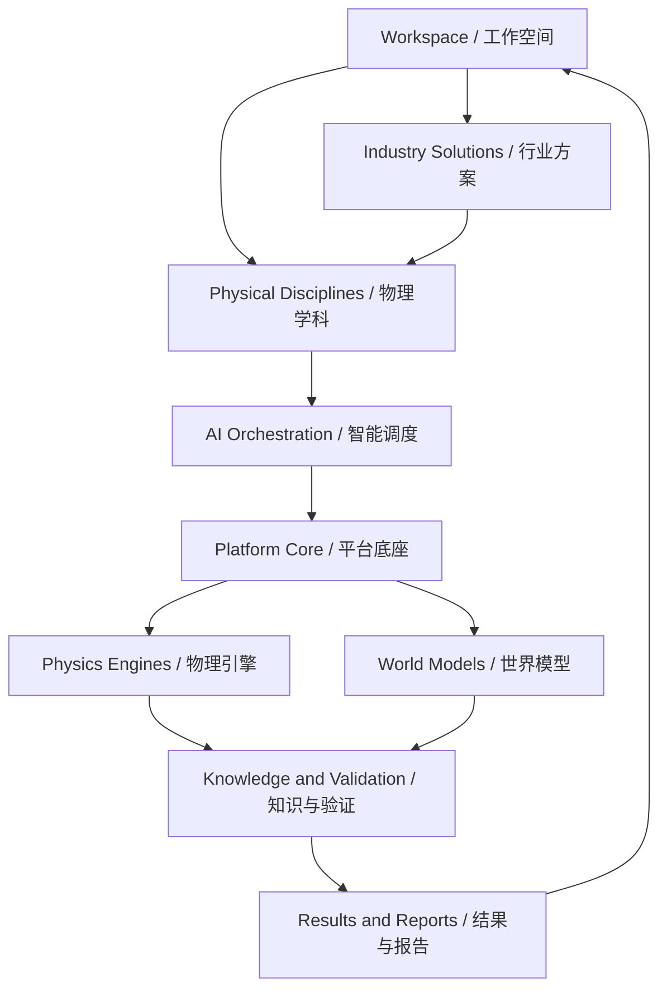

# WuMo.ai Product Strategy & Technical Architecture V1.0
# WuMo.ai 产品规划与技术架构 V1.0

2026-11-27 | Proposed engineering baseline / 建议研发基线

Source / 依据: [Current landing page source / 当前首页源码](https://github.com/hogoai/wumo.ai/blob/main/index.html), and the agreed product discussions / 已确认的产品讨论。Technical choices below are proposals, not evidence of implemented functionality. / 以下技术选型属于建议，不代表已经实现。

## 1. Mission / 产品使命
**Understand. Simulate. Optimize. — Intelligence for the Physical World.**
理解物理世界，模拟物理世界，优化物理世界。

WuMo is an AI-native physical computing platform intended to combine AI, numerical physics, world models and engineering knowledge in one workspace. Target users are engineers, researchers, technical SMEs and industrial design teams. Initial value: faster preliminary analysis, transparent assumptions and reproducible comparisons, not replacement of certified engineering review.
WuMo 是融合 AI、数值物理计算、世界模型与工程知识的统一工作空间。目标用户为工程师、研究人员、技术型中小企业与工业设计团队。初期价值是加速初步分析、透明呈现假设、可复现地比较方案，而非替代正式工程审核。

## 2. Product portfolio / 产品体系

| Physical discipline / 基础学科 | Scope / 范围 | Candidate engines / 候选引擎 |
|---|---|---|
| Mechanics 力学 | Beams, frames, stress, stability / 梁、框架、应力、稳定性 | NumPy, SciPy, PyNite, CalculiX |
| Fluids 流体 | Aerodynamics, pipes, ventilation / 气动、管道、通风 | OpenFOAM, SU2 |
| Electromagnetics 电磁 | Motors, antennas, EMC / 电机、天线、电磁兼容 | Elmer FEM, openEMS, Meep |
| Materials 材料 | Properties, selection, microstructure / 性能、选材、微观结构 | ASE, LAMMPS |
| Thermodynamics 热力学 | Heat transfer, energy balance / 传热、能量平衡 | CoolProp, Cantera; numerical heat solvers / 数值传热求解器 |
| Multiphysics 多物理场 | Coupled thermal, structural, fluid and electromagnetic systems / 热、结构、流体、电磁耦合 | Elmer FEM, MOOSE |

Multiphysics is a cross-disciplinary coupling capability rather than a separate fundamental science. / 多物理场属于跨学科耦合能力，而非独立基础科学。

| Industry solution / 行业方案 | Example / 示例 | Shared capabilities / 共享能力 |
|---|---|---|
| Energy 能源 | Wind farm layout, PV yield / 风场布局、光伏发电量 | Fluids, mechanics, thermal; FLORIS, pvlib |
| Mobility 交通车辆 | Drag, durability, battery cooling / 风阻、耐久、电池冷却 | Fluids, mechanics, materials, thermal, EM |
| Industrial 工业 | Machinery loads, vibration, cooling / 设备载荷、振动、散热 | Mechanics, thermal, EM, materials |
| Spatial 建筑空间 | Daylight, wind comfort, exhibition structures / 日照、风舒适度、展览结构 | Mechanics, fluids, world models |

Industry modules reuse discipline services and own only domain-specific inputs, workflows and reports. / 行业模块复用学科服务，仅负责行业参数、工作流及报告。

## 3. Architecture / 总体架构



The AI layer proposes structured inputs and selects registered methods; deterministic application code enforces permissions, schemas and execution rules. The two engine families are not interchangeable: numerical solvers calculate within defined physical assumptions; world models represent or predict scenes and may generate plausible but unverified behavior. / AI 层提出结构化参数并选择已注册的方法；确定性程序负责权限、契约与执行规则。双引擎不可互相替代：数值求解器在明确物理假设下计算，世界模型表达或预测场景，其生成结果可能合理但未经验证。

## 4. Core components / 核心构件

| Component / 构件 | Responsibility and interface / 职责与接口 |
|---|---|
| Workspace | Projects, input editor, result viewer, comparison, exports / 项目、参数编辑、结果查看、比较、导出 |
| API Gateway | Versioned REST, auth, quotas, request IDs / 版本化 REST、认证、配额、请求 ID |
| Project Store | Projects, immutable input snapshots, runs, artifacts / 项目、不可变输入快照、计算记录、产物 |
| AI Orchestrator | Extract parameters, identify missing values, propose method, explain results / 参数提取、缺项识别、方法建议、结果解释 |
| Engine Registry & Router | Register engine ID, version, capabilities, input schema and limits; dispatch only supported tasks / 注册引擎 ID、版本、能力、输入契约及限制，仅调度支持的任务 |
| Physics Adapter | validate, execute, normalize results / 校验、执行、标准化结果 |
| World Model Adapter | Provider capability, scene input/output, provenance / 供应商能力、场景输入输出、来源记录 |
| Job Manager | Run lifecycle, timeout, cancellation, retry policy / 任务生命周期、超时、取消、重试策略 |
| Knowledge Service | Versioned material properties, equations, standards references / 版本化材料参数、公式、标准引用 |
| Validation Service | Units, range, assumptions, benchmark checks and warnings / 单位、范围、假设、基准核验及警告 |
| Report Service | Inputs, method, results, provenance, limits and review status / 输入、方法、结果、来源、局限及复核状态 |

## 5. Engineering workflow / 工程工作流
1. Describe / 描述：accept text, structured input and later drawings / 接收文字、结构化输入，后续支持图纸。
2. Understand / 理解：extract quantities, identify missing parameters, never invent values / 提取参数、识别缺项、不编造数值。
3. Configure / 配置：confirm units, geometry, material, loads, boundaries and method with user / 用户确认单位、几何、材料、荷载、边界及方法。
4. Simulate / 模拟：execute registered solver with recorded version and inputs / 调用注册求解器并记录版本及输入。
5. Validate / 验证：check applicability, units, reference cases and uncertainty / 检查适用性、单位、参考案例及不确定性。
6. Optimize / 优化：compare explicit objectives and constraints, retain baseline / 比较明确的目标和约束，保留基准方案。

## 6. Data contracts and API / 数据契约与接口

Proposed canonical SI units internally; preserve original units for display. / 内部统一 SI 单位，保留原始单位用于展示。

```json
{
  "schema_version": "1.0",
  "task_type": "mechanics.cantilever.tip_load",
  "inputs": {
    "length_m": 2.0,
    "elastic_modulus_pa": 210000000000,
    "width_m": 0.05,
    "height_m": 0.1,
    "tip_load_n": 500
  },
  "assumptions": ["linear_elastic", "small_deflection", "ideal_fixed_support"]
}
```

Result contract / 输出契约: run_id, status, engine_id, engine_version, input_snapshot, quantities with units, assumptions, validation_status, warnings, artifacts, created_at. AI explanations are separate from solver results. / AI 解释与求解结果分开存储。

| Endpoint / 接口 | Purpose / 用途 |
|---|---|
| GET /api/v1/health | Service readiness / 健康检查 |
| GET /api/v1/engines | Registered capabilities / 已注册能力 |
| POST /api/v1/runs | Validate and submit task / 校验并提交任务 |
| GET /api/v1/runs/{id} | Status and result / 状态与结果 |
| GET /api/v1/runs/{id}/report | Reproducible report / 可复现报告 |

Lifecycle / 生命周期: submitted → validated → running → succeeded or failed; cancellation where supported / 支持时允许取消。Invalid inputs must return structured errors, not fabricated results. / 无效输入返回结构化错误。

## 7. First MVP: Mechanics V1 / 首个 MVP
Implement a rectangular cantilever with an ideal fixed support and transverse tip load using Euler–Bernoulli beam theory. / 实现理想固支、端部横向集中荷载的矩形悬臂梁，采用 Euler–Bernoulli 梁理论。

I = b h³ / 12; tip deflection / 端部挠度 = F L³ / (3 E I); maximum bending stress magnitude / 最大弯曲应力幅值 = F L h / (2 I).

Reference case / 基准案例: L=2 m, b=0.05 m, h=0.10 m, E=210 GPa, F=500 N. I=4.1666667e-6 m⁴; deflection=1.5238095 mm; stress=12 MPa. Excludes self-weight, shear deformation, buckling, plasticity and connection flexibility. / 不考虑自重、剪切变形、屈曲、塑性与连接柔度。

Acceptance / 验收: reference values within relative tolerance 1e-6; reject nonfinite or nonpositive geometry and modulus; test zero load, sign convention, unit conversion and scaling; return applicability warnings; show inputs and formulas in report. No claim of certified structural safety. / 基准相对误差不超过 1e-6；拒绝非有限或非正几何及弹性模量；测试零荷载、符号约定、单位换算和比例关系；提供适用性警告；报告展示输入与公式。不宣称正式结构安全认证。

## 8. Technology and repository / 技术选型与目录
Proposed modular monolith: Python, FastAPI, Pydantic, pytest; NumPy/SciPy when needed. SQLite for local prototype, PostgreSQL when multi-user persistence is required. Preserve static landing page and existing language support. Add a separate application frontend when justified. / 建议模块化单体：Python、FastAPI、Pydantic、pytest，按需引入 NumPy/SciPy。本地原型使用 SQLite，多用户持久化时采用 PostgreSQL。保留静态首页及现有语言体系，按需新增应用前端。

```text
index.html
assets/
backend/
  app/
    api/
    core/
    engines/mechanics/
    orchestration/
    knowledge/
    validation/
  tests/
docs/
benchmarks/
```

Create only directories needed by the current phase. Evaluate engine licenses, hosting costs and resource isolation before integration. / 仅创建当前阶段所需目录；接入引擎前评估许可证、托管成本与资源隔离。

## 9. Reliability, security and governance / 可靠性、安全与治理
- Version material data, formulas, solver builds and benchmarks; record sources and applicable conditions. / 材料数据、公式、求解器及基准均版本化，记录来源和适用条件。
- Separate numerical verification, physical validation and professional review; a passing benchmark is not certification. / 区分数值核验、物理验证与专业审核；基准通过不等于认证。
- Treat AI outputs and uploaded content as untrusted; enforce schemas and allowlisted engines; no arbitrary code execution. / AI 输出及上传内容均视为不可信，执行契约校验及引擎白名单，不允许任意代码执行。
- Keep API keys server-side, isolate user data, redact logs, provide retention and deletion controls; assess GDPR and provider data transfers before launch. / API 密钥保存在服务端，隔离用户数据、日志脱敏、提供保留与删除控制；上线前评估 GDPR 和供应商数据传输。
- Limit CPU, memory, job duration and uploads; introduce sandboxed workers before running external solvers. / 限制 CPU、内存、任务时间和上传规模；运行外部求解器前引入隔离工作进程。

## 10. Roadmap and acceptance gates / 路线图与验收

| Phase / 阶段 | Deliverable / 交付 | Gate / 验收 |
|---|---|---|
| 1 Landing V1.1 | Product vision, 6+4, bilingual architecture plus existing German site / 产品愿景、6+4、架构及现有德语网站 | Source present; browser and deployment checks pending / 源码已有，浏览器及部署待核实 |
| 2 Core V0.1 | FastAPI, schemas, registry, run interface / API、契约、注册表、任务接口 | Local startup, health and contract tests pass / 本地启动、健康检查及契约测试通过 |
| 3 Mechanics V1 | Cantilever solver and report / 悬臂梁求解与报告 | Reference case and invalid-input tests pass / 基准与无效输入测试通过 |
| 4 Knowledge & Validation | Versioned materials, benchmark registry / 材料版本、基准注册 | Traceable inputs and reproducible results / 输入可追溯、结果可复现 |
| 5 AI Orchestration | Natural language to confirmed task / 自然语言转确认后的任务 | Missing parameters block execution; AI cannot alter numeric results / 缺项阻止执行，AI 不得修改数值结果 |
| 6 Energy & Fluids | First wind/PV tool, scoped fluid methods / 首个风电或光伏工具及有限流体方法 | Reference datasets and domain limits documented / 参考数据与适用范围明确 |
| 7 World Models | Provider adapter and scene viewer / 供应商适配及场景查看 | Provenance, failure handling and clear nonvalidated labels / 来源、异常处理、未验证标记 |
| 8 Multiphysics | One explicit coupled benchmark / 一个明确耦合基准 | Coupling convergence and reference comparison / 耦合收敛与参考比较 |

## 11. Current status / 当前状态
Confirmed from landing source: three-language content, 6+4 portfolio, architecture diagram, workflow, qualitative spring-mesh demonstration and early-access presentation. / 首页源码确认：三语内容、6+4 产品体系、架构图、工作流、定性弹簧网格演示与早期体验介绍。
Not verified: live deployment, waitlist delivery, browser runtime, backend, real solvers, AI routing, database, workspace and provider integrations. / 未核实：线上部署、等候名单实际送达、浏览器运行、后端、真实求解器、AI 调度、数据库、工作空间与供应商接入。
The spring-mesh demo is not a validated FEM solver. / 弹簧网格演示不是经过验证的有限元求解器。

## 12. Commercial path and version control / 商业路径与版本管理
Start with free preliminary calculators and user feedback; evaluate paid project workspaces, professional reports and metered API access only after reliable computation and demand are demonstrated. / 先以免费初步计算工具收集反馈；可靠计算和需求得到验证后，再评估付费工作空间、专业报告及按量 API。 Pricing is not yet decided. / 定价未确定。

Use main as reviewed baseline, feature branches and pull requests; require tests and human review before merge. Tag releases after verification, maintain changelog and architecture decision records. Never commit secrets. / main 作为审核基线，功能分支及 PR 开发，测试与人工审核后合并；验证后打版本标签，维护变更日志与架构决策记录；禁止提交密钥。

All AI coding assistants must inspect the repository first, preserve unrelated changes, implement only the agreed phase, report files and tests, and never describe planned capabilities as live. / 所有 AI 编程助手必须先检查仓库、保留无关修改、仅实施约定阶段、报告文件与测试，不得将规划能力描述为已上线。

## 13. Immediate next task / 下一项任务
Audit repository and local environment; establish a minimal FastAPI service with health endpoint, typed cantilever input contract and tests. Do not alter the landing page or introduce external solvers yet. / 审查仓库与本地环境；建立最小 FastAPI 服务、健康检查、类型化悬臂梁输入契约及测试。暂不修改首页或引入外部求解器。
